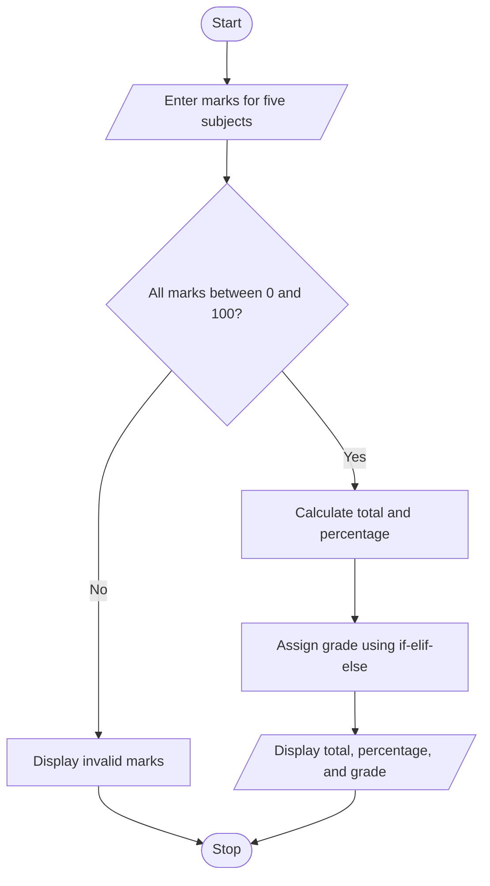

# Student Grade Calculator

## 1. Problem Statement
Create a Python program that accepts marks for five subjects, calculates the total and percentage, and displays a grade.

## 2. Objectives
- Accept marks using `input()` and convert them to numbers.
- Calculate total and percentage using arithmetic operators.
- Use `if-elif-else` to assign a grade.

## 3. Assumptions
- Each subject is marked out of 100.
- Marks must be between 0 and 100.
- Grade rules for this educational example: 90+ = A, 80+ = B, 70+ = C, 60+ = D, otherwise E.

## 4. Algorithm
1. Start.
2. Read marks for five subjects.
3. Check that each mark is between 0 and 100.
4. Calculate total and percentage.
5. Use if-elif-else to find the grade.
6. Display total, percentage, and grade.
7. Stop.

## 5. Flowchart
See [flowchart.mmd](flowchart.mmd). GitHub can display Mermaid diagrams when embedded in Markdown.



## 6. Pseudocode
```text
START
INPUT five subject marks
IF any mark is outside 0..100, DISPLAY error
ELSE
    total = sum of marks
    percentage = total / 5
    IF percentage >= 90: grade = A
    ELSE IF percentage >= 80: grade = B
    ELSE IF percentage >= 70: grade = C
    ELSE IF percentage >= 60: grade = D
    ELSE: grade = E
    DISPLAY total, percentage, grade
STOP
```

## 7. Python Source Code
Run [main.py](main.py) using Python 3 or PyCharm.

## 8. Test Cases
| Input marks | Expected result |
|---|---|
| 90, 85, 80, 95, 90 | Total 440/500; percentage 88.00%; grade B |
| 60, 60, 60, 60, 60 | Total 300/500; percentage 60.00%; grade D |
| Any mark above 100 | Invalid marks message |

## 9. Sample Output
```text
Total marks: 440/500
Percentage: 88.00%
Grade: B
```

## 10. Conclusion
This program calculates student marks and assigns a grade using variables, type conversion, arithmetic operators, lists, loops, and conditional statements.

## Syllabus Mapping
- Unit I: Variables, data types, input/output, type conversion, arithmetic operators.
- Unit II: for loop and if-elif-else.
- Unit III: Lists and list traversal.

**Before submission:** Run the program yourself and add a screenshot of the actual output.
