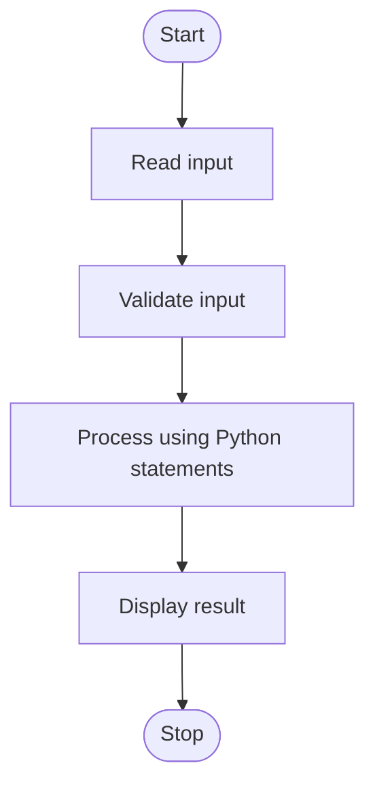

# Number Guessing Game

## 1. Problem statement
Number Guessing Game: solve a small practical problem using introductory Python.

## 2. Objectives
- Practise input/output and variables.
- Apply conditions, loops, strings, lists, sets, or tuples as appropriate.
- Display a clear result.

## 3. Assumptions
- The user enters values in the format requested by the program.
- This is an educational demonstration; validate inputs and adapt it to faculty requirements.

## 4. Algorithm
1. Start the program.
2. Read the required input.
3. Validate input where applicable.
4. Process the data using Python statements.
5. Display the result and stop.

## 5. Flowchart


## 6. Pseudocode
```text
START
INPUT required values
VALIDATE values
PROCESS using conditions/loops/data structures
DISPLAY result
STOP
```

## 7. Python source code
See [main.py](./main.py).

## 8. Test cases and expected results
- 3 → Too low; 9 → Too high; 7 → correct
- Try a boundary or invalid input where applicable.

## 9. Conclusion
This project demonstrates beginner Python programming and problem-solving. Run the program and attach screenshots of your actual output before submitting.

## Syllabus mapping
Introductory Python: input/output, variables, operators, conditions, loops, strings, and/or collections. Explain the code yourself during evaluation.